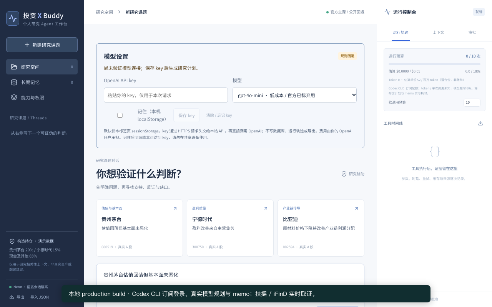
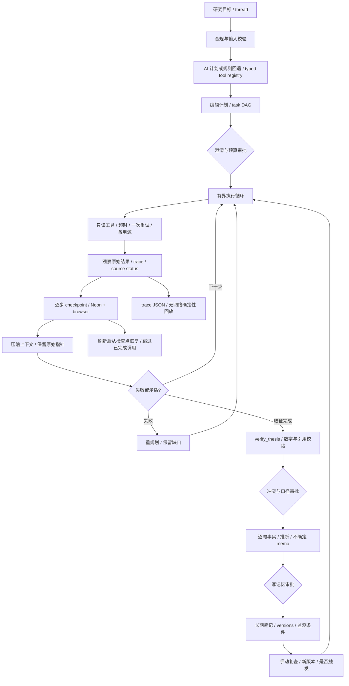

# 投资 X Buddy

面向个人投资研究者的 Agent 工作台。把“估值回落但基本面未恶化”一类判断，推进为可修订的计划、真实数据证据链与可追溯研究备忘录。

**Web**：https://thesis-lab-mu.vercel.app （最终生产别名以 [FINAL_STATUS](docs/FINAL_STATUS.md) 为准）  
**源码**：本目录完整源代码；本轮仅只读检查 git status / diff，没有提交或推送。提交者需上传到自己的仓库并填写仓库链接。
**演示**：[本地 Codex CLI 真实模型演示 MP4](docs/demo/demo.mp4) · [重录讲稿](docs/demo/SCRIPT.md)



## 用户与产品选择

题目 13 要求同时体现投资研究体验和 Agent Harness。选择个人研究者，围绕一个核心任务“验证投资命题”，避免把时间花在无法验证的聊天能力或交易执行上。研究者先看到缺口，再决定补证和何时改变判断。默认三个真实 A 股课题：贵州茅台估值与基本面、宁德时代主营盈利归因、比亚迪产业链成本传导。所有持仓均为显著标注的构造数据，用于相关性上下文。

## 启动方式

Node.js 22+（本轮 Node 26 验证）。

```bash
npm ci
cp .env.example .env.local
npm run dev
# http://localhost:3000
npm test
npm run typecheck
npm run build
# 启动 dev 或 production server 后
npm run test:e2e
npm run eval
BASE_URL=https://your-app.vercel.app npm run test:e2e
BASE_URL=https://your-app.vercel.app npm run eval
```

Playwright 首次使用需 `npx playwright install chromium`。`npm run demo:llm` 录制本地 Codex CLI 真实模型，完整命令见 docs/demo/SCRIPT.md。旧 `npm run demo` 是规则路径脚本。视频转码需 ffmpeg；脚本可使用 FFMPEG_PATH。

## 环境变量

| 变量 | 用途 / 未配置行为 |
|---|---|
| `LLM_PROVIDER` | 设为 `codex-cli` 启用本机 CLI；不设则公开 BYOK / Gateway / 规则路径。Vercel、VERCEL_ENV、DEPLOYMENT_ENV=production 或非 loopback 请求拒绝 CLI |
| `AI_GATEWAY_API_KEY` | 本地可选；Vercel 部署使用 OIDC。失败显式规则回退 |
| `AI_GATEWAY_MODEL` | 默认 `openai/gpt-5-mini`，Vercel AI SDK `generateText` / `Output.object` |
| `DATABASE_URL` | Neon serverless Postgres；缺失或失败退回 localStorage，UI 显示同步状态 |
| `FUYAO_API_KEY` | 官方 `X-api-key` REST 适配器，无密钥不调用 |
| `IFIND_TOKEN`（`IFIND_MCP_URL` 可选） | 官方 Streamable HTTP；默认新闻公告服务 URL，Authorization 使用原值；无密钥不调用 |

前轮通过 `npx vercel integration add neon` 创建并连接 Neon，本轮继续复测恢复。所有 `.env*`（包括示例文件）、`.vercel/`、依赖和测试产物被 gitignore 排除，服务端密钥不进入浏览器 bundle 或 trace；用户 BYOK 仅保存在所选浏览器存储。[真实协议及开通步骤](docs/PROVIDER_SPECS.md)。

## 设计与 Agent 机制



三栏：左侧课题、记忆与构造持仓；中间目标、可编辑计划、证据、memo、对比和追问；右侧轨迹、预算、上下文与审批。

- **Thread** = 研究课题对话（Run）；**Task** = 带目标、工具、输入、依赖、完成条件的 PlanStep；**Evidence** = 证据卡；**Artifact** = memo / 公司对比表。长久笔记与运行检查点分开。
- Zod 工具注册：行情、K线、财务、估值、公告、命题核验、公司对比、记忆读写。能力页公开 schema、权限、时延和费用估算。只读授权；记忆写入须审批；没有交易或外部发送能力。
- 执行上限：10 次、估算 $0.05、180 秒活跃执行时间、连续 3 次工具失败；用户可停止。工具当前调用返回后停止后续步骤，保留响应。审批等待不计入活跃时长。
- 软调用预算可调，计划超额需明确批准；硬上限不可绕过。重规划保留失败 trace，必要时将待执行价格背景步骤改为原始公告检索。
- 默认上下文预算 1800 估算 tokens。旧结果压缩为摘要与 trace 指针；全部原始响应保留。压缩仍超预算则停止。窗口显示目标、计划、偏好、构造持仓、长期笔记、置顶事实和结果摘要；核验模型收到证据摘要及压缩后的运行上下文。
- 每步完成保存 checkpoint；`?simulateCrash=step3` 在第三次工具调用后中断。刷新恢复不重调已有结果。确定性回放仅播放已存 trace，不重新采样模型或请求数据。
- 审批：澄清期间可选，内容可编辑；预算超额、证据冲突与代理指标判断、记忆写入均批准 / 按编辑批准 / 拒绝；事件入 trace。
- 成本显示真实返回 token 数乘明确标注的混合估算价 $2 / 百万 tokens（不是账单）。公开工具费用估算为零；失败请求若供应商未返回 usage，其计费未知。每步时延、重试、缓存与来源可查。瀑布条用时延画宽度、执行顺序画偏移。

## AI 角色与验证

所有者不购买 API key 或添加信用卡。公开视频使用**本地 Codex CLI 真实模型**；公网评审使用 BYOK 或明确标注的规则回退。历史 Gateway 403 是账号计费限制，仍保留为可选路径，不再要求所有者开通。

「模型设置」默认 `gpt-4o-mini`（[官方模型页](https://developers.openai.com/api/docs/models/gpt-4o-mini)，存在但已标弃用；实际权限以评审账户为准），可选 [`gpt-5.6-terra`](https://developers.openai.com/api/docs/models/gpt-5.6-terra)。key 默认仅 sessionStorage，勾选记住才写 localStorage；输入框始终密码遮罩，保存后清空，不回显。清除按钮删除两处存储。key 经 HTTPS `x-openai-key` 请求头发送本站 API，再由 AI SDK OpenAI provider 直接调用 OpenAI；不经 Gateway、不写 Neon、日志、trace、导出或记忆。请求日志不采集 headers；遥测关闭。浏览器同源脚本可读本机存储，共享设备不要选择记住。

优先级：用户 key → 显式启用且允许的本地 Codex CLI → Gateway → 规则回退。无效 key 不转用所有者额度；401 / 403 / 429 / 超时 / 格式或守卫失败显示原因与规则回退。所有 LLM 路由均有每 IP 每分钟 120 次的进程内限制（多实例不共享，非生产级分布式限流）。

本地：`LLM_PROVIDER=codex-cli npm run dev`，要求 `~/.local/bin/codex` 已登录。生产构建亦可本机 `LLM_PROVIDER=codex-cli npm start -- --hostname 127.0.0.1`；`NODE_ENV=production` 不等于托管部署。CLI 使用 `codex exec` 只读 sandbox、ephemeral、独立临时目录、忽略用户配置 / 规则、关闭 shell 工具，`--output-schema` / `-o` 后再 Zod 校验，60 秒超时杀进程并删除临时文件。复用同一 planner、工具执行、memo、守卫与审批。仅模型传输不同。[官方非交互模式](https://learn.chatgpt.com/docs/non-interactive-mode)。本地指进程位置，推理仍发送研究上下文到 OpenAI；不是离线模型，也不把订阅登录暴露到公网。CLI token / 单次费用未知、消耗订阅配额；瀑布展示 planner 和 memo 实际时延及超时政策。

模型负责结构化计划、证据审阅、保守 memo 与追问；程序掌握工具权限、依赖、停止、审批、数字允许集和缺口边界。AI 不发明财务数值。模型不可用或格式 / 数字 / 引用 / 分类校验失败时，标记规则回退并保留模板输出。

数字核对只接受被引用 Evidence.values 中的标准化数字，拒绝原始 metadata、未引用证据或模型自行生成的数字，亦拦截中文量词数字。它证明数值有来源，**不证明**单位语义、统计推断或因果正确。每条 memo 句子标记事实 / 推断 / 不确定，点击证据 ID 可看 raw 字段、来源 URL、抓取时刻、单位、口径、报告期与 as-of。

## 数据

主源为 **扶摇 REST 与 iFinD MCP**，由注册工具实际调用，不只保留在 trace：

- `get_quote` / `get_kline`：扶摇最新成交价与不复权日线。校验 HTTP 和 ApiResponse `code=0`，从 `data.item` 取证券精确匹配记录。
- `get_financials`：扶摇合并营业收入、营业利润、归母净利润原币元，保留报告期末、披露日和累计口径；不把 `quarterly` 参数误读为单季，也不凭空生成扣非同比。
- `get_valuation`：扶摇 PE TTM、PE MRQ、PB MRQ 独立证据。不能与 Eastmoney 动态 PE 互换。
- `search_announcements`：iFinD `search_notice` 的真实公告语义片段，使用起止日期。片段可能是摘要、被截断或混排合并表/母公司表，因此不自动抽取为定量事实。CNINFO 保留原始公告 PDF 入口。

Eastmoney 行情、动态 PE/PB、日线、主要财务指标与利润表是**标注的公开补充 / 回退**：主源可用时分列交叉核验，主源失败时继续公开取数；新浪只补行情。公开同比仍可用于有限的经营改善判断，但不冒充扶摇指标。每条证据保留 provider、抓取时刻、数据时点、单位、统计口径、报告期与 raw 字段。跨供应商金额、报告期和估值口径分歧进入冲突面板，不平均、不覆盖。`primary` 表示原始披露材料属性，不等于供应商调用优先级。

本轮茅台、宁德时代、比亚迪均进行了真实授权取数；完整成功/失败状态及截断样本见 [端点探测](docs/ENDPOINT_PROBES.md) 和 `docs/provider-probe-results.json`。不能把同花顺两个接口一致当作独立来源核验。公告片段不等于全文；历史可比估值、主营归因、成本传导仍可能无法验证。60 秒进程缓存显式记录命中，手动复查绕过缓存。

时效：行情 >4 自然日或时点未知降级；财务报告期 >200 天降级。阈值是本产品演示政策，非交易日历规则。抓取时刻不等于数据时点；“最新可得”不保证最新应披露报告期。缺失、停牌线索、失效时点、空响应与调用失败均无法验证，不补零。`?simulateFail=eastmoney` 展示模拟 503、一次重试、备用来源、重规划和缺口。

## 长期状态、边界与未做事项

Neon 按 HttpOnly / SameSite 匿名随机 cookie 隔离工作区；没有登录、跨设备账号、多人协作或权限审计身份保证。浏览器副本优先作为恢复点，可 JSON 导出 / 校验导入；清空本地副本仍可从相同 session 的 Neon 恢复。清除 cookie 后不会自动找回匿名空间，需导入 JSON。检查点包含研究过程；只有通过记忆审批才成为长期笔记。

版本保留命题前后文本、指标快照差异与引用。监测为手动重新核验：同口径扣非同比跨零可自动判断；公告更正、分部归因等需人工正文，显示无法判断。低置信度是固定保守等级，不是概率校准。公司比较逐指标并列，口径与报告期不一致时不能直接排序；追问仅基于已有证据。

不提供直接买卖、目标价、确定性涨跌预测、仓位指令或收益承诺；拒绝后引导回可验证指标。无真实持仓、用户画像或受限数据。尚未实现 PDF 全文抽取、历史 PE 序列、自动后台监控、完整多轮聊天记录、全市场证券主数据校验、语义事实校验或生产级身份 / 防滥用 / 多标签冲突合并。请勿将演示当成交易系统或多用户生产服务。

## 验证与交付

[测试说明](docs/TESTING.md) · [五目标 eval](docs/EVALS.md) · [AI 使用与验证记录](docs/AI_LOG.md) · [最终状态](docs/FINAL_STATUS.md)。
